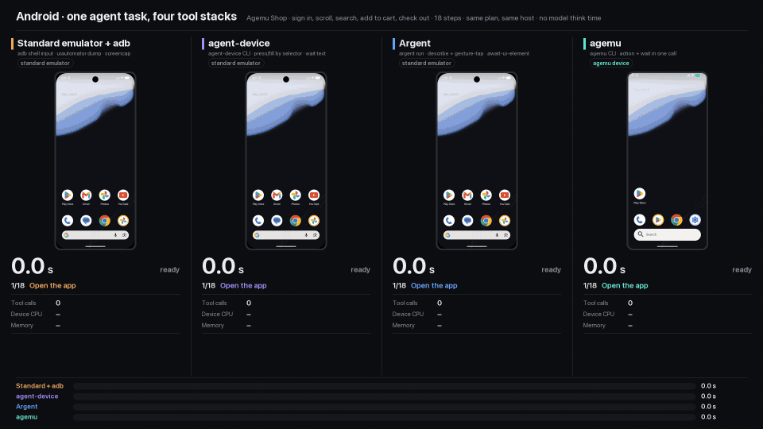
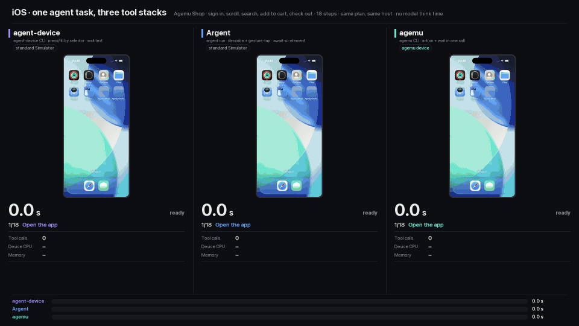

# agentic-emulator (`agemu`)

[](https://www.npmjs.com/package/agentic-emulator)
[](https://github.com/piotr-graczyk-dev/agentic-emulator/actions/workflows/ci.yml)
[](LICENSE)

An agent-first runtime for the Android emulator and the iOS Simulator on Apple Silicon Macs. LLM
agents drive headless devices through a CLI or an MCP server: screenshots, the UI tree, taps,
typing, apps, test capabilities, logs and crashes.

```sh
claude mcp add agemu -- npx -y agentic-emulator@latest mcp
```

The guest operating systems are stock (the SDK's arm64 Android image, Xcode's iOS Simulator
runtime), so apps behave as they do on the standard emulator and Simulator. agemu replaces the
**control plane**, where `adb`, `simctl` and Maestro spend an agent's time: a long-lived daemon,
emulator gRPC with a shared-memory frame stream, a warm on-device Android agent, and an in-process
iOS helper for the framebuffer, touch and accessibility.

[](examples/agent-race/out/montage.mp4)

One agent task with four tool stacks, real time until agemu finishes:
[montage (67 s)](examples/agent-race/out/montage.mp4) ·
[Android race](examples/agent-race/out/android/race.mp4) ·
[iOS race](examples/agent-race/out/ios/race.mp4) ·
[results](#one-task-four-tool-stacks-recorded)

[agemu vs the standard tools](#agemu-vs-the-standard-tools) ·
[What it costs](#what-agemu-does-not-speed-up-and-what-it-costs) · [Install](#install) ·
[Use](#use) · [MCP](#mcp) · [Settings](#settings) · [Proof](#proof)

## agemu vs the standard tools

The same device and the same stock OS, the standard tool and agemu run back to back, except where
a note says otherwise. Medians over agemu's daemon connection, as `agemu mcp` uses it. One `agemu`
process per call, as a shell-using agent runs it, adds a few ms: a tap is then 11× faster instead
of 172×, a screenshot 18×, a UI tree read 233-337×. How it was measured:
[below](#how-these-numbers-were-measured).

### Each agent action

| Agent action | Android: `adb` / `uiautomator` → agemu | iOS: `simctl` / Maestro → agemu |
|---|---|---|
| screenshot (full-size PNG), still screen | 152.9 → **4.4 ms** (35×) ¹ | 145.7 → **4.5 ms** (33×) |
| read the UI tree | 1,994.7 → **1.9 ms** (1051×) ¹ | 7,103.7 → **23.0 ms** (309×, Maestro) |
| tap | 52.7 → **0.3 ms** (172×) ¹ | Maestro at a point: 8,385 ms per call (1.6 s each in a flow of 10) → **159-160 ms** by selector ² |
| reset to a clean state | 14.1 s cold boot → **2.1 s** (6.6×) ³ | 35.7 s `shutdown` + `erase` + boot → **2.1 s** (17.2×, CLI, n=2) ³ |
| read an app's newest log lines | 252 ms `logcat -d` → **0.56 ms** | 961 ms `log show` → **1.11 ms** |
| the app crashes during a `wait` ⁴ | no crash notice: the wait runs to its timeout → **`app_crashed` after 30-169 ms** | no crash notice: the wait runs to its timeout → **`app_crashed` after a median 199 ms** |
| grant, revoke or reset a permission | 30.4-35.5 → **2.6-4.2 ms** | 116-130 → **1.5-4.7 ms** |
| open a deep link | 34.7 → **3.7 ms**, app in front ⁵ | 120 → **6.7 ms** |
| read light or dark appearance | 22.8 → **0.8 ms** | 175 → **1.0 ms** (setting it is slower: see [costs](#what-agemu-does-not-speed-up-and-what-it-costs)) |
| send a push notification | no faithful path, so not implemented | 133 → **15.8 ms** |

1. Android, since this benchmark: `tap` returns once the input is queued, `adb shell input` after
   the app has handled it, so follow with `wait`, `ui` or `screenshot`. A tap by selector now waits
   for the screen to settle (+0.1 ms on a still screen, +72-821 ms right after a transition), a
   screenshot right after an input waits up to 500 ms for that input's frame (medians 261-809 ms
   in the reliability runs; the benchmark's screenshot right after a screen change was 13.4×), and
   a UI tree read costs 0.6-1.0 ms more. None of these was re-run against `adb`.
2. Separate runs, not side by side: Maestro's tap at a point in the benchmark, agemu's current tap
   by selector (it returns once its first frame shows, at most 120 ms) later.
3. Android: agemu's reset is the emulator's own snapshot load, at parity with
   `adb emu avd snapshot load` (2.36 s, 1.1×); the gain is against a cold boot. iOS: a soft reset
   (user apps, grants, keychain, pasteboard, appearance, location); built-in apps' data stays,
   which `erase` would wipe. 12.0× in the other run that day.
4. `adb` and `simctl` give no crash notice. The timeouts (10 s, 15 s) were measured as agemu's own
   `wait` with log capture off, in separate series (on iOS about 70 minutes later, not
   interleaved). Android: medians per crash kind, n=8 each. iOS: a median over 60 crashes on an
   earlier build; 114-146 ms on the merged build (CLI, n=3 per kind).
5. A deep link that cold-starts an Android app is 0.9× (222 → 261 ms): the OS does that work.

Every capability row, with list apps, uninstall, clear-data and clipboard:
[Test capabilities](#test-capabilities). Every benchmark row, CLI included:
[Speed in detail](#speed-in-detail).

### Each device

| Per device | Standard | agemu |
|---|---|---|
| Android emulator, memory at idle | 7.5 GB, the AVD as Android Studio runs it (4 GB guest, window, audio) | **4.3 GB** cold-booted (2 GB guest, no window); 5.4 GB after baseline loads ⁶ |
| Android emulator, idle CPU | 86% of a core | **19%** cold-booted; 24% after baseline loads ⁶ |
| Android baseline snapshot on disk | 2.04-2.05 GB, the emulator's raw format | **0.83-0.89 GB**, LZ4 |
| iOS simulator, memory with no app | 4.0 GB, all services | **2.5 GB**, launchd jobs an app under test does not use turned off ⁷ |
| iOS simulator, idle CPU | 20% of a core | **1.5%** ⁷ |

6. Single sessions on a busy host. Idle CPU of one emulator swung from 5.8% to 93.4% of a core
   between 30 s windows. Memory is macOS's `phys_footprint`, which in a later run under heavy swap
   exceeded the emulator's summed memory regions by 1.3-2.1 GB for an unknown reason, as much as
   the gap after baseline loads. Details: [Android](#android).
7. Single runs, with the previous lean setting (32 launchd jobs off), the only one compared with
   the full Simulator directly. The current setting was measured against that one step by step, in
   separate series that do not chain: 2.42 → 1.97 GB 2 minutes after agent-ready (49 jobs, 4
   pairs), 2.09 → 1.85 GB 4 minutes after agent-ready (background work stopped), and 67.9 → 41.4
   CPU-seconds in the first minute from a simulator's second boot (wallpaper gallery kept from
   starting). Details: [iOS](#ios).

### Against other agent tools

A React Native app's 23-step flow on one iOS simulator (sign in with an e-mail code, search, open
a result, switch tabs, scroll, sign out), every step waiting for the screen it leads to. 5
interleaved rounds, medians, with an earlier agemu build (before the lean devices and the
reliability waits). The ranges overlap (agemu 26.2-35.4 s, Argent 34.1-41.2 s); an earlier series
at lower load gave 1.14× and 2.10×. Details: [A real app](#a-real-app-against-other-agent-tools).

| | agemu (action and wait in one call) | Argent 0.32 | agent-device 0.21 |
|---|---|---|---|
| whole flow | **29.7 s** (32.6 s with one call per action and per wait) | 38.8 s (1.31× slower) | 65.5 s (2.21× slower) |
| after the app is up (14-17 s launch excluded) | **15.8 s** | 21.1 s (1.34×) | 47.6 s (3.01×) |
| tool calls (agent turns) | **26** | 51 | 36 |
| one UI tree / one screenshot | **24-122 ms / 18-26 ms** | 188-513 ms / 159-212 ms | 304-455 ms / 484-700 ms |
| taps the app did not act on (retried; counted in the times) | 5 in 52 runs | 2 in 23 | none in 20 |

### One task, four tool stacks, recorded

An 18-step shopping task in the [Agemu Shop example app](examples/shop) (sign in, scroll, search,
cart, checkout), the same agent plan driven by each tool stack's CLI with no model think time:
the standard emulator with `adb` and `uiautomator`, agent-device 0.21.36 and Argent 0.32.0 on
standard devices, and agemu on agemu devices. 3 runs per stack, the order rotated each round, all
21 completed. vs: **std** and vs: **agent**. Method and caveats:
[examples/agent-race](examples/agent-race).

| Android: `adb`, agent-device, Argent, agemu | iOS: agent-device, Argent, agemu |
|---|---|
| [](examples/agent-race/out/android/race.mp4) | [](examples/agent-race/out/ios/race.mp4) |
| [full race, real time (mp4)](examples/agent-race/out/android/race.mp4) | [full race, real time (mp4)](examples/agent-race/out/ios/race.mp4) |

The GIFs run in real time until agemu finishes, then sped up; the timers keep the true time. Both
races in one video: [montage (67 s)](examples/agent-race/out/montage.mp4).

| task time | standard + `adb` | agent-device | Argent | agemu |
|---|---|---|---|---|
| Android | 73.3-74.9 s (7.0×) | 24.0-24.8 s (2.4×) | 29.4-30.4 s (2.8×) | **10.4-10.7 s** |
| iOS | - | 35.0-37.3 s (2.2×) | 17.8-18.5 s (1.1×) | **16.5-17.0 s** |

N× is how much longer than agemu (medians). On iOS most of the time is the app's, and Argent,
which taps by coordinates without waiting for a still screen and scrolls without momentum, is
close; agemu's lean simulator held half the memory (2.1-2.3 against 4.3-4.6 GB). Each stack's
tool calls: `adb` 64, agent-device 26-33, Argent 66, agemu 34-35.

### What agemu fixed in the agent loop

These rows compare agemu with its own earlier build on probe apps, with the next call sent the
moment the previous one returned. `adb`, `simctl` and Maestro were not run on them. Details:
[Reliability](#reliability).

| Scenario | Before | Now | Cost |
|---|---|---|---|
| iOS: tap a button of a just-presented alert, action sheet or sheet | 26-49 of 50 lost, per kind | **0 of 50** | +1-37 ms against a tap that landed; action sheets +305 ms |
| iOS: launch an app right after `key home`, or `reset` on the home screen | 59 of 60 sent to the background | **0 of 60** | `key home` 0.66-1.3 s instead of 5-23 ms |
| iOS: `type` into slowed fields, a web view, Settings' search | 147 of 560 doubled or lost | **0 of 700** ⁸ | +0.5-0.7 ms; web view +87 ms |
| Android: tap by selector right after the screen moved | 107 of 199 failed | **5 of 200** | +72-821 ms per such tap (that arm ran at higher load in 4 of 5 blocks); +0.1 ms on a still screen |
| Android: screenshot right after an input | 35 of 120 showed the old screen | **5 of 120** | waits up to 500 ms for the input's frame |
| Android: first UI tree read after an app crash | 5.0 s (native crash, abort) | **110-113 ms** | +0.6-1.0 ms per ordinary read |

8. The final build's slowed runs were not alternated with the old build; the alternated
   intermediate build had 2 wrong of 1,400.

With 1 s or 3 s of think time the Android taps did not fail without the wait either (0 of 120
each); the wait then cost +84-91 ms (1 s, 3 of 4 scenarios) or nothing (3 s).

### How these numbers were measured

- **Host.** One Apple M2 Pro Mac (12 cores, 16 GB, macOS 26.6) that other work used at the same
  time: other sessions' emulators and simulators, builds, browsers. Load averages ranged from about
  3 to 450 across the runs and swap was often in use, so absolute times are noisy. Arms ran back
  to back or interleaved; the exceptions are stated with each result.
- **Ratios.** N× is the standard tool's time over agemu's; below 1×, agemu is slower. The tables
  above list the standard tool first (152.9 → 4.4 ms), the Test capabilities table agemu first
  (3.7 / 34.7 ms).
- **Speed.** `agemu-bench` on 2026-11-06 ([bench/final/](bench/final/)), before the later changes
  in note 1. [Speed in detail](#speed-in-detail) has every row and what changed.
- **Capabilities.** n=12 per arm, interleaved. **Logs:** n=15 (Android), n=12 (iOS; `log show`
  returned more lines).
- **Baselines.** The sections below mark each table: **vs: std** for the standard tools and
  devices (`adb`, `uiautomator`, `simctl`, Maestro, the emulator as Android Studio runs it, the
  full Simulator, the raw snapshot), **vs: agent** for other agent tools, and **vs: prev** for an
  earlier agemu build: f4286db (the last merged build) or a build of a later round of work
  ("round 4", "round 5"). A prev row shows what a change did inside agemu, not a lead over the
  standard tools.
- Every run's n, host load and method is in [docs/](docs/).

## What agemu does not speed up, and what it costs

- **Boots and launches belong to the OS and the app.** An iOS cold boot is 0.7-1.2× `simctl boot`
  plus `bootstatus` (agemu waits until the home screen is drawn). App launches are 1.0× over the
  daemon (0.6-0.9× through the CLI). A profile switch is 0.2× on Android (agemu waits for the app
  to lay out again) and 0.7× on iOS (a cold boot of another device type).
- **The Android reset is the emulator's snapshot load**, at parity with the emulator's own
  command. Within 3 s of the previous load it waits for the emulator (5.05-5.08 s), and in a
  non-native profile laying the screen out again adds 1.85-2.93 s.
- **Android typing is only 1.7-3.2× faster** (41.6 against 72.0 ms for a word; 1.4-2.4× through
  the CLI): agemu waits until the app has applied the text, so that `type` followed by `ui` is
  consistent.
- **The reliability waits cost time** when the agent does not pause: iOS `key home` takes 0.66-1.3
  s instead of 5-23 ms, an Android tap by selector right after a change +72-821 ms, an Android
  screenshot right after an input up to 500 ms. With four devices running a flow with no think
  time, f4286db (before these waits) completed 25.5 flows per minute against 21.2-22.8, about 70%
  of the gap from its faster Android flow; the builds were not alternated per configuration.
  `AGEMU_ANDROID_TAP_WAIT=0` and `AGEMU_IOS_TAP_SETTLE=0` turn the tap waits off; the `key home`
  wait, the paste confirmation, the iOS tap's first-frame wait (at most 120 ms) and the Android
  screenshot wait have no switch ([Reliability](#reliability)).
- **iOS appearance and typing wait for iOS.** Setting the appearance takes 684 against 130 ms for
  `simctl ui appearance` (it waits for the 0.5 s crossfade; a screenshot shows the change as soon,
  1.0×, the UI tree 2.9× later). `type` with no focused field sends 3 Cmd-Vs and took 1.6-2.6 s,
  and a readable field that rejects a paste gets two pastes and about 4.5 s (designed, not
  measured).
- **More devices do not add up.** On the 16 GB Mac the total levels off at 2.2-2.7 one-device
  units from 3 devices on, and the lighter devices did not move it
  ([Several devices at once](#several-devices-at-once)).
- **Keeping devices ready keeps their memory**: a booted simulator held 1.8-2.5 GB, and an
  Android device in standby keeps its 2 GB of guest RAM until a second `shutdown`.
- **Parking frees CPU, not memory**: on this swapping host it freed about 0.1 GB more than leaving
  a simulator idle (n=3), and timers that come due during a park fire at the resume (about 41 s
  late after 60 s parks). Parking two idle simulators automatically did not speed up a third one
  in use (7.31 against 7.22 s per flow). [Parking](#parking-idle-devices).
- **The compressed Android snapshot costs CPU**: 3.99 against 2.06 emulator CPU-seconds per
  reset. Its faster resets (1.75 against 2.28 s) were measured on a disk other sessions shared;
  on a quiet disk raw resets took 1.36 s, so the gain can vanish or reverse. [Android](#android).
- **Log capture is not free**: an iOS app's own logging took 29.2 against 24.3 ms per 1000 lines
  while the stream ran, an Android app's `Log.i` calls in a 5,000-line burst 7.54 against 6.43 ms,
  and an overflowing Android burst kept fewer lines in logd (3,153 against 4,618, n=4, p≈0.06).
  [Logs and crashes](#logs-and-crashes).
- **Opt-in speed-ups change behaviour** (`AGEMU_ANDROID_ANIMATIONS=0`, `AGEMU_IOS_ANIMATIONS=0`),
  and lean devices drop features an app under test rarely needs (iOS widgets, Siri, Shortcuts
  actions); `AGEMU_IOS_LEAN=0` and `AGEMU_ANDROID_LEAN=0` keep them.
- **Private APIs, and a Simulator is not a device.** iOS support uses private CoreSimulator,
  SimulatorKit and AccessibilityPlatformTranslation APIs and a private log line of iOS 26.5's
  `pasted`; any Xcode release can break them (tested on Xcode 26.6 with iOS 26.5). The Simulator
  runs apps natively on the Mac. [Known limitations](#known-limitations).

## Install

```sh
claude mcp add agemu -- npx -y agentic-emulator@latest mcp
```

That is the whole install for Claude Code. `npx` fetches the
[`agentic-emulator`](https://www.npmjs.com/package/agentic-emulator) package on first use: three
native binaries, 13 MB, no Node code and no install script. With `@latest` each new session
runs the newest release, and a session that starts a newer release restarts the shared daemon on it (devices keep
running). Then check this Mac:

```sh
npx -y agentic-emulator doctor
```

`agemu doctor` checks everything below per platform and prints the commands that fix what is
missing. One platform is enough: an iOS-only or Android-only Mac is fine.

```text
$ agemu doctor
agemu
  ✓ Apple Silicon Mac      macOS 26.6 (arm64)
  ✓ agemud                 ~/.local/bin/agemud
  ✓ daemon                 not running (the first command starts it)
  ✓ on PATH                ~/.local/bin/agemu

iOS  ready
  ✓ Xcode                  Xcode 26.6 (/Applications/Xcode.app/Contents/Developer)
  ✓ iOS Simulator runtime  iOS 26.5
  ✓ agemu-ios-helper       ~/.local/bin/agemu-ios-helper

Android  not ready
  ✓ Android SDK            ~/Library/Android/sdk
  ✓ Java                   /Applications/Android Studio.app/Contents/jbr/Contents/Home
  ✓ command-line tools     ~/Library/Android/sdk/cmdline-tools/latest/bin
  ✓ emulator               ~/Library/Android/sdk/emulator
  ✓ platform-tools (adb)   ~/Library/Android/sdk/platform-tools
  ✗ system image           not installed: system-images;android-37.1;google_apis_playstore_ps16k;arm64-v8a

To fix
  1. yes | ~/Library/Android/sdk/cmdline-tools/latest/bin/sdkmanager --licenses > /dev/null
     ~/Library/Android/sdk/cmdline-tools/latest/bin/sdkmanager --install 'system-images;android-37.1;google_apis_playstore_ps16k;arm64-v8a'    # the image takes about 8 GB of disk
  Then run `agemu doctor` again.
...
```

### The `agemu` command

Agents that use a shell, and scripts, want `agemu` on `PATH`:

```sh
npm install -g agentic-emulator
# or without Node, into ~/.local/bin (checks the release's SHA256SUMS):
curl -fsSL https://raw.githubusercontent.com/piotr-graczyk-dev/agentic-emulator/main/install.sh | sh
```

If `install.sh` says `~/.local/bin` is not on `PATH`, run the line it prints first. Then the
first device:

```sh
agemu create --platform ios --name iphone && agemu boot agemu-iphone
agemu screenshot -o shot.png
```

Every command prints JSON, and `agemu help` lists them. Through `npx`, a command is
`npx -y agentic-emulator <command>`, which adds Node's start-up to each call; an agent that runs
one command per action should use the installed `agemu`.

### What it needs

| | Needed for | Get it |
|---|---|---|
| Apple Silicon Mac | everything | |
| Xcode with an iOS Simulator runtime | iOS | the App Store, open it once, then `xcodebuild -downloadPlatform iOS` (iOS 26.5: 16 GB on disk) |
| Android SDK: emulator, platform-tools, command-line tools | Android | Android Studio, or `brew install --cask android-commandlinetools` |
| the arm64 system image `system-images;android-37.1;google_apis_playstore_ps16k;arm64-v8a` | Android | `sdkmanager --install '<image>'` (8.2 GB on disk); another image: `AGEMU_ANDROID_IMAGE` |
| Java 17+ | creating Android devices (the SDK's `avdmanager`) | Android Studio's bundled runtime is found by itself, or `brew install --cask temurin` |
| Node.js | only for the `npx` and `npm` installs | `brew install node` |

No environment variables are needed for the usual layouts. The Android SDK is found at
`$ANDROID_HOME`, `$ANDROID_SDK_ROOT`, `~/Library/Android/sdk` (Android Studio) or
`/opt/homebrew/share/android-commandlinetools` (Homebrew), in that order; Java at `$JAVA_HOME`,
the JDK `/usr/libexec/java_home` picks, or Android Studio's. A Mac without Android Studio, from
nothing:

```sh
brew install --cask android-commandlinetools temurin
yes | sdkmanager --licenses > /dev/null
sdkmanager --install emulator platform-tools 'system-images;android-37.1;google_apis_playstore_ps16k;arm64-v8a'
```

### Connect an agent

`agemu mcp` is an MCP server on stdio.

| Client | |
|---|---|
| Claude Code | `claude mcp add agemu -- npx -y agentic-emulator@latest mcp` (`--scope user` for every project) |
| Codex CLI | `codex mcp add agemu -- npx -y agentic-emulator@latest mcp` |
| Cursor, Claude Desktop, other JSON configs | `{"mcpServers": {"agemu": {"command": "npx", "args": ["-y", "agentic-emulator@latest", "mcp"]}}}` |

Apps started from the Dock do not see your shell's `PATH`. If one cannot find `npx`, put the path
`which npx` prints in `command`, or install `agemu` and use the absolute path `agemu doctor`
prints.

### Update and uninstall

| Installed with | Update | Uninstall |
|---|---|---|
| `npx` | nothing to do: each session runs the latest release | `claude mcp remove agemu` |
| `npm install -g` | `npm install -g agentic-emulator@latest`, then `agemu daemon restart` | `agemu daemon stop && npm uninstall -g agentic-emulator` |
| `install.sh` | run it again | `agemu daemon stop && rm ~/.local/bin/{agemu,agemud,agemu-ios-helper}` |
| source | `git pull && make install` | `make uninstall` |

`install.sh` and `make install` restart a running daemon on the new build; after an npm update,
the next MCP session does it, or `agemu daemon restart` at once. MCP sessions reconnect by
themselves and devices keep running. The automatic restarts (install.sh, `make install`, an MCP
session) wait while the daemon prepares a new Android device's baseline, since a restart cancels
the preparation; `agemu daemon restart` does not wait (it warns), so run it once `agemu daemon
status` lists no preparing device. Uninstalling leaves the devices you created: `agemu-*` AVDs
(`avdmanager delete avd -n agemu-pixel`) and `agemu-*` simulators (`xcrun simctl delete <udid>`),
and the state in `~/.agemu`.

### From source

Building needs Go (the version in `go.mod`) and Swift (Xcode or `xcode-select --install`):

```sh
git clone https://github.com/piotr-graczyk-dev/agentic-emulator.git
cd agentic-emulator
make install     # build, copy to ~/.local/bin (PREFIX=/usr/local for another place), run agemu doctor
```

`agemu` is a thin client: it starts the `agemud` next to it on first use, and all CLI processes
and MCP sessions share that one daemon. State lives in `$AGEMU_HOME` (default `~/.agemu`). The
on-device Android agent's jar is committed; rebuilding it needs a JDK and the Android SDK. More in
[CONTRIBUTING.md](CONTRIBUTING.md).

### When something does not work

- **Run `agemu doctor`.** It does not start the daemon and took 0.6 s here.
- **A change or an upgrade has no effect.** The daemon keeps running the binary it started from.
  An MCP session restarts a daemon older than itself when it starts; otherwise `agemu version` and
  `agemu doctor` say when it is out of date, and `agemu daemon restart` fixes it without touching
  running devices.
- **A setting is ignored.** The daemon reads `AGEMU_*`, `ANDROID_HOME` and `JAVA_HOME` from the
  process that started it, which may be an MCP client that does not have your shell's
  environment. Set them in the MCP config's `env`, or run `agemu daemon restart` from your shell.
- **`agemu create --platform android` fails.** The error carries `avdmanager`'s last lines; a
  missing image or Java shows up in `agemu doctor` first.
- **The daemon log:** `~/.agemu/daemon.log`; `agemu daemon status` prints its path and the pid.
- **Still stuck:** [open an issue](https://github.com/piotr-graczyk-dev/agentic-emulator/issues/new/choose)
  with `agemu doctor --json`.

## Use

```sh
agemu create --platform android --name pixel          # -> android:agemu-pixel
agemu create --platform ios --profile iphone-17-pro    # -> ios:<udid> named agemu-iphone-17-pro
agemu boot android:agemu-pixel                         # from the baseline: seconds; from standby: tens of ms
agemu launch com.android.settings
agemu ui                                               # compact outline: [ref] role "text" id=... @(x,y wxh)
agemu tap --text "Network & internet"                  # or: tap 393 614, tap --id ..., --contains ...
agemu wait --text Internet                             # re-reads the UI tree as the screen changes
agemu tap --text "Network & internet" --wait-text Internet --ui   # act, wait and observe in one call
agemu type "hello"                                     # into the focused field
agemu key back                                         # home, back, enter, delete, tab, escape, lock, ...
agemu screenshot -o shot.png                           # pixels = the profile's resolution
agemu profile small-phone                              # or --width 900 --height 1800 --density 360 (Android)
agemu reset                                            # back to the clean baseline
agemu park                                             # stop the device in place: no CPU, app kept
agemu resume                                           # or any next call on it resumes it
agemu shutdown                                         # Android: standby, memory kept; a second shutdown powers off
agemu profiles                                         # all real-device profiles
```

All coordinates are screenshot pixels, on both platforms. With exactly one booted device, `-d
<device>` can be left out.

Actions (`tap`, `swipe`, `type`, `key`, `launch`, `open`, `push`) take
`--wait-text/--wait-id/--wait-contains/--wait-role` (plus `--wait-gone`, `--wait-timeout-ms`) to
wait for their effect in the same call, and `--ui` to also return the screen they end on: one call
per agent step instead of two or three.

A tap by selector waits until the element can take the touch: on Android until no window
transition runs and the element has stopped moving (bounded, about 5 s at worst; at once on a screen
unchanged for 0.5 s); on iOS until the screen is still and a just-presented alert or sheet can take
touches. A tap by coordinates on Android does not wait. See [Reliability](#reliability).

### MCP

`agemu mcp` serves 31 tools over stdio (setup per client: [Connect an agent](#connect-an-agent)): `devices`, `profiles`, `create`, `boot`, `shutdown`, `reset`, `park`, `resume`,
`set_profile`, `screenshot` (returns the image), `ui_tree`, `find`, `tap`, `swipe`, `type_text`,
`press_key`, `install`, `launch`, `terminate`, `wait_for`; for the test capabilities `open_url`,
`permission`, `location`, `clipboard`, `appearance`, `apps`, `uninstall`, `clear_app_data`, `push`;
and `logs`, `crashes`.

The server handles tool calls concurrently, so `devices` answers while another call runs. A new
Android device's first `boot` returns state `preparing` at once: the baseline takes 7-8 minutes, at most 20,
once. The agent then polls `devices` until the device is `booted`, so no tool call outlasts a 60 s
client timeout.

## Test capabilities

```sh
agemu open myapp://orders/7 --wait-id order-7          # a deep link, as a tapped link opens it
agemu permission grant com.example.app camera location # also revoke, and reset [<name>...]
agemu location set 52.2297 21.0122                     # simulated GPS fix; location clear
agemu clipboard set "code 1234"                        # clipboard prints it back
agemu appearance dark                                  # appearance alone reads light|dark
agemu apps                                             # user-installed apps: id, name, version
agemu clear-data com.example.app                       # like a fresh install, app kept
agemu uninstall com.example.app
agemu push com.example.app '{"aps":{"alert":"Hi"}}'    # iOS only; payload inline, a file or -
```

vs: **std**. Each is the system call the standard tool makes, sent from agemu's long-lived
on-device agent (Android) or helper (iOS) instead of a new process per call. Daemon (MCP) medians
against the standard tool, n=12 per arm, interleaved, on a loaded host; details and caveats in
[docs/CAPABILITIES.md](docs/CAPABILITIES.md).

| Operation | Android: agemu / `adb` | iOS: agemu / `xcrun simctl` |
|---|---|---|
| open a deep link | 3.7 / 34.7 ms (9.4×), app in front; 261 / 222 ms (0.9×), app stopped | 6.7 / 120 ms (18×) |
| grant, revoke, reset a permission | 2.6-4.2 / 30.4-35.5 ms (7.5-12.3×) | 1.5-4.7 / 116-130 ms (28-78×) |
| set a location (the call) | 0.6 / 16.3 ms; the app sees the fix no sooner (1.0×) | 0.5-0.8 / 107-109 ms |
| clipboard set, get | set 2.4 ms, get 1.8 ms (no standard tool) | set 0.8 / 133 ms (159×), get 11.7 / 161 ms (14×) |
| read the appearance | 0.8 / 22.8 ms (28×) | 1.0 / 175 ms (174×) |
| set the appearance | 27.2 / 67.4 ms (2.5×) on the home screen | 694 / 670 ms until a screenshot shows it (1.0×); the call waits for the 0.5 s crossfade |
| list user apps | 8.5 / 28.0 ms (3.3×; one user app installed) | 0.7 / 173 ms (another mechanism: Info.plists on the host) |
| uninstall | 61.7 / 119.1 ms (1.9×) | 83 / 194 ms (2.3×) |
| clear app data | 35.6 / 79.3 ms (2.2×) | 258 / 538 ms (2.1×; delete and reinstall from a clone) |
| push | not implemented (no faithful path) | 15.8 / 133 ms (8×) |

`reset` restores what these change: light appearance, the baseline location, an empty clipboard,
no permission grants, no user apps. On Android that is the 2.1 s snapshot load plus the
emulator's default GPS fix, which is emulator state that a snapshot does not hold; on iOS it is the
2.1 s soft reset, against 35.7 s for `simctl shutdown` + `erase` + boot, which also wipes built-in
apps' data. A capability a platform cannot do faithfully answers "not implemented" (exit
status 3) instead of faking it: on Android push and the `photos-add`, `contacts-limited`,
`reminders` and `siri` permissions; on iOS the photos grant, `contacts-limited`, notifications and
raw Android permission names.

## Profiles

| Platform | Profiles | How they switch |
|---|---|---|
| Android | `pixel-9-pro`, `pixel-9`, `galaxy-s24`, `small-phone`, `pixel-fold-inner`, `pixel-tablet`, or a custom size with `profile --width W --height H --density D` | At runtime with a display size and density override; no reboot. |
| iOS | `iphone-17-pro-max`, `iphone-17-pro`, `iphone-17`, `iphone-air`, `iphone-16e`, `iphone-se-3`, `ipad-mini`, `ipad-pro-11` | The screen is fixed per simulator device type, so agemu switches to an `agemu-<profile>` simulator. |

## Lighter devices and settings

Each device runs a whole guest OS, so most of its memory and CPU is iOS's or Android's; agemu's
daemon and iOS helper took 21 MB before log capture, which adds 12-22 MB. agemu turns off, in its
own devices, what an app under test does not use.

### iOS

agemu turns off 49 launchd jobs (widgets, Siri, photo analysis, asset downloads, Continuity, ...),
stops the wallpaper gallery after a cold boot (all but the lock screen's wallpaper), stops what iOS
starts in the background after boot and then keeps idle (the Calendar app, App Intents extensions,
device management services; a Calendar that is in front at a pass is never stopped), ends the
on-demand daemons that then stay idle and clean, the way a phone's jetsam does under memory
pressure (launchd starts them again at the next request; daemons found behind public app APIs, and
any started once an app is installed, launched or opened, are kept), and from a
simulator's second boot keeps the gallery from starting at all (PosterBoard's keynote mode).
`AGEMU_IOS_LEAN=0` keeps the full system. What a lean simulator does not do (home screen widgets,
Siri, Shortcuts actions, refreshed wallpaper suggestions, ...):
[docs/IOS.md](docs/IOS.md#lean-simulators).

Against the full Simulator (vs: **std**). Only the previous lean setting (32 jobs, an older gallery
stop) was compared with it directly; the summed processes of one simulator:

| per simulator | all services (`AGEMU_IOS_LEAN=0`) | previous lean setting (32 jobs) |
|---|---|---|
| memory, no app (single runs) | 4.0 GB | 2.5 GB |
| idle CPU, no app (single runs) | 20% of a core | 1.5% |
| memory, React Native dev app open (3 boots each way, interleaved) | 4.82 GB | 3.90 GB |
| simulator CPU during an app flow right after boot (45 s window) | 148 s | 101 s |
| simulator CPU during the flow, settled | 34 s | 33 s |
| the app flow itself | 25.7 s | 25.9 s (the app's pace) |
| cold boot to agent-ready | 9.3 s | 8.4 s |

Each later step against the build before it (vs: **prev**). These are separate series, each with
its own boots and host load, so they do not chain into one controlled comparison with the full
system:

| step | before | after | n |
|---|---|---|---|
| 49 jobs instead of 32, gallery stop that spares the lock screen: memory 2 min after agent-ready | 2.42 GB | 1.97 GB (-19%) | 4 pairs of boots (a 55-job list, in the same state as 49) |
| background work stopped once idle: memory 4 min after agent-ready | 2.09 GB | 1.85 GB | 6 pairs; iOS had opened Calendar in all 12 boots, about 0.15 GB otherwise (estimated) |
| gallery kept from starting, second boot on: simulator CPU in the first minute after agent-ready | 67.9 CPU-s | 41.4 CPU-s (-39%) | 6 pairs; a device's first boot is unchanged |
| the same: memory 2 min after agent-ready | 1.86 GB | 1.75 GB | 6 pairs |
| idle daemons ended after boot (daemons found behind public app APIs kept): memory 4 min after agent-ready | 1.76 GB | 1.62 GB (-8%) | 4 pairs, the shipped build; with AgemuTestApp open 1.84 → 1.69 GB |

On the lean device a probe app's notifications, Contacts, EventKit, MapKit, Apple Pay sheet,
StoreKit, WatchConnectivity and keyboards behaved as expected (not compared with the full system).
With keynote mode the lock screen, its poster switcher, the wallpaper gallery and its editor opened
after all 9 boots checked (and after 4 boots without it: 13 of 13 in all); the home screen was
looked at in 2 screenshots; setting a new wallpaper and contact posters were not checked.

`AGEMU_IOS_ANIMATIONS=0` (opt-in) shortens UIKit and SwiftUI animations (durations and delays
×0.05). From a tap to the end of the transition, summed over a test app's screens: 4.8× less time
(SwiftUI) and 7.4× (UIKit) by big frame changes (3.6× and 6.5× counting any change); a 15-call
agent flow took 6.87 s instead of 12.51 s over the 4 normal-speed runs without a failed tap
(13.26 s over all 5, one with a 10 s timeout). Sheets keep their speed, timers do not change, and a
toast with a 2 s delay can be gone before an agent looks. Apps launched after the setting use it,
SpringBoard from the next boot; see [docs/IOS.md](docs/IOS.md#fast-animations-opt-in).

### Android

`-gpu host` by default (without a window, `-gpu auto` picks SwiftShader, whose worker threads spin
at idle), and 14 Google apps are turned off in the baseline (12 exist in this image; Play services,
the Play Store, WebView and the keyboard stay). The emulator process of one AVD; see
[docs/ANDROID.md](docs/ANDROID.md#host-gpu-and-lean-devices-2026-11-06-evening):

| per emulator | as Android Studio runs it (vs: **std**) | agemu before: `-gpu auto`, apps on (vs: **prev**) | agemu now: host GPU, lean |
|---|---|---|---|
| memory | 7.5 GB (4 GB guest) | 5.94 GB | 5.44-5.51 GB after baseline loads; 4.3 GB cold-booted (2 GB guest) |
| idle CPU | 86% of a core | 54-79% | 24-25%; 19% cold-booted |
| first minute after a cold boot | 202% of a core | - | 120% |
| cold boot to `sys.boot_completed` | 19.3 s | - | 9.0-12.6 s; agent-ready from the baseline in 5.1 s |
| agent step: find + tap + wait for the next screen + screenshot | - | 1506 ms | 866 ms; 357-379 ms with `AGEMU_ANDROID_ANIMATIONS=0` |
| cold app launch (Settings) | - | 602 ms | 151 ms (`adb`'s `am start -W` also: 601 -> 186 ms) |

Memory and CPU are single sessions on the busy host; read-only cold-booted instances were measured
the same way. agemu gives the guest 2 GB of RAM (`-lowram`, which on emulator 37.1 does not make it
a low-RAM device), Android Studio's run 4 GB, a window, audio and the boot animation. Idle CPU
swings with the guest's own background work: 30 s windows of one emulator ranged from 5.8% to 93.4%
of a core. Memory is macOS's `phys_footprint`. In a later run under heavy swap (12-14 GB), the
emulator's `phys_footprint` exceeded the sum of its memory regions by 1.3-2.1 GB, for a reason not
known: as large as the difference after baseline loads (5.4 against 7.5 GB). The agent step and
launch rows are
`agemu-bench` medians.

- **Compressed baseline** (vs: **std**, the emulator's raw format). The baseline snapshot's RAM is
  saved LZ4-compressed: 0.83-0.89 GB of disk per AVD instead of 2.04-2.05 GB. With other sessions
  sharing the disk (load average 6-52), resets took 1.75 against 2.28 s (medians of 12 per format,
  alternated), 2.35 against 2.66 s with the snapshot read from the SSD each time (medians of 10).
  Powered-off boots took 2.31 against 2.48 s (n=8), but in 4 blocks at a higher host load the
  compressed boots were slower (3.26 against 2.89 s). Each reset costs the emulator more CPU, as
  LZ4 decompresses on 12 threads: 3.99 against 2.06 CPU-seconds, 6.01 against 2.38 with the
  snapshot read from the SSD (medians). On a quiet disk raw loads can be as fast or faster
  (1.36 s on 2026-11-06); that was not measured again. agemu always sets the emulator's
  `ANDROID_SNAPSHOT_COMPRESS`; `AGEMU_ANDROID_SNAPSHOT_COMPRESS=0` keeps the baseline raw. See
  [docs/ANDROID.md](docs/ANDROID.md#caveats) (Disk).
- **Quiet baseline** (vs: **prev**, the baseline saved 20 s after boot). A snapshot restores the work
  the guest had pending, so it ran again after every reset and boot: Play Store jobs and app
  updates, the app freezer's compactions, Play services' flag push. agemu now saves the baseline
  once the guest has been up 7 minutes and its last minute was quiet (CPU and network). Emulator CPU
  in the 2 minutes after a reset, old baseline against quiet:
  - a new device's first boot: 154 -> 17.1 CPU-s (n=4, 6);
  - a retake of an older device: 54.0 -> 11.5 (n=8 each, interleaved);
  - a baseline saved late on a very busy host: 14-18 -> about 11 (n=3, not interleaved).
  - the merged round-6 build against main, a new AVD each with its own default baseline (8 resets
    per arm, interleaved): 183 (52-197) -> 12.6 (12.3-13.0); idle afterwards 14.9% -> 9.6% of a core.
    main's figure grew with the baseline's age: 52 two minutes after it was saved, 178-197 later.

  Resets, boots and the agent step were not slower. There is no memory saving: `phys_footprint` read
  0.9-1.1 GB lower, but the emulator's region footprint was the same on both (3.0-3.2 GB).

  The cost is the first boot of a new device (or a retake): 430-455 s measured,
  never more than 20 minutes (a hard bound: the boot then fails and the next one prepares again). It does not block clients:
  - the device shows state `preparing` with its phase;
  - MCP `boot` and `agemu boot --no-wait` return at once;
  - `agemu boot` waits with progress on stderr;
  - other calls on the device fail at once (CLI exit status 5).

  Existing devices keep their baseline until it is retaken. A baseline days old replays somewhat more
  (+6.6 CPU-s per restore at 3 days, wall-clock work). `AGEMU_ANDROID_BASELINE_UPTIME_S=0` saves at
  once. See [docs/ANDROID.md](docs/ANDROID.md#quiet-baseline-2026-11-08).
- **Frame stream idle stop** (vs: **prev**, f4286db). After 30 s without calls agemu stops its frame
  stream if the screen is still posting frames, and the next call restarts it. With an app that
  keeps animating, emulator plus daemon CPU fell from 57.5% to 39.9% of a core (n=7 per arm). The
  first screenshot after a stop took 9 ms longer, and an input then a screenshot after a stop took a
  median 498 against 261 ms (it waited for fresher frames). See
  [docs/ANDROID.md](docs/ANDROID.md#frame-stream-idle-stop-2026-11-06-night).
- `AGEMU_ANDROID_ANIMATIONS=0` (opt-in) sets the system animation scales to 0 after every boot,
  resume and reset, as Espresso setups do.

### Several devices at once

On the 16 GB Mac, with another session's emulator, simulator and builds running, each device ran an
agent flow with no think time (15 calls on iOS, 16 on Android), all at the same time (CLI;
per-session medians of 4-12 flows per device; `AGEMU_IOS_MAX_BOOTED=6`, since at the default agemu
would have shut simulators down; [docs/IOS.md](docs/IOS.md#several-devices-at-once)). No standard
tool was run; the f4286db figures are vs: **prev**:

| devices running the flow | each device's speed, of its speed alone | total, in one-device units |
|---|---|---|
| 2 (iPhone 17 Pro, Android) | 0.97-1.00 | 1.98-1.99 |
| 3 (+ iPhone SE) | 0.62-0.91 (0.62 in one 4-flow session) | 2.17-2.68 |
| 4 (+ iPad mini) | 0.51-0.67; f4286db 0.58-0.65 | 2.27-2.43; f4286db 2.42 |
| 5 (+ iPhone 17) | 0.49-0.54 | 2.59 |

The total levels off from 3 devices on. Each device's CPU per flow and the host's paging grew as
devices were added, while agemu's daemon, helper and log streams took 0.1-0.8 CPU-s per flow. The
lighter devices did not move the curve. With 4 devices f4286db completed more flows per minute
(25.5 against 21.2-22.8): about 70% of the gap because its Android flow was faster alone (3.8
against 5.7 s: the tap and screenshot waits at zero think time), the rest because its iOS flows
were 3-13% faster at 4 devices; the builds were not alternated per configuration. Parking two more
idle devices did not speed up the three active ones.

### Settings

Daemon settings: set them in the environment of the `agemu` call that starts the daemon. To change
one, stop the daemon (`pkill -x agemud` stops every agemu daemon of your user; the devices keep
running); the next `agemu` call starts it again. Per-platform
tables: [docs/ANDROID.md](docs/ANDROID.md#run-it), [docs/IOS.md](docs/IOS.md).

| Variable | Default | Effect |
|---|---|---|
| `AGEMU_HOME` | `~/.agemu` | State directory and the daemon's socket. |
| `AGEMU_IOS_LEAN` | on | `0`: the full Simulator (jobs back from the next boot, keynote mode removed). |
| `AGEMU_IOS_IDLE_EXIT` | on | Lean simulators end the on-demand daemons that stay idle after boot, except those found behind public app APIs. `all`: those too (an app's first call to one then waits for its restart, up to 2-3 s); `0`: none. |
| `AGEMU_IOS_IDLE_KEEP` | unset | Comma-separated daemon names (executable file names) that are never ended as idle. |
| `AGEMU_ANDROID_LEAN` | `1` | `0`: keep the Google apps (applies when a baseline is taken). |
| `AGEMU_ANDROID_GPU` | `host` | `auto`: software rendering. |
| `AGEMU_ANDROID_SNAPSHOT_COMPRESS` | `1` | `0`: raw baseline (applies when a baseline is taken). |
| `AGEMU_ANDROID_BASELINE_UPTIME_S` | `420` | Guest uptime (and a quiet minute) the baseline waits for; a first boot then takes 7-8 min (at most 20), during which the device is `preparing`; `0`: save at once (applies when a baseline is taken). |
| `AGEMU_ANDROID_FIRSTBOOT_REPAIR` | `1` | `0`: do not boot an AVD whose first boot was interrupted before it ever completed with `-wipe-data` (two interruptions about 10 s in leave it unbootable otherwise). |
| `AGEMU_ANDROID_STREAM_IDLE_S` | `30` | Seconds without calls before the frame stream of a changing screen stops; `0`: never. |
| `AGEMU_ANDROID_ANIMATIONS` | normal | `0`: system animations off. |
| `AGEMU_IOS_ANIMATIONS` | normal | `0`: UIKit and SwiftUI animations ×0.05 (or a factor from 0.05 to 1). |
| `AGEMU_ANDROID_TAP_WAIT` | `1` | `0`: taps by selector do not wait for transitions or motion. |
| `AGEMU_IOS_TAP_SETTLE` | on | `0`: taps and typing do not wait for a still screen, nor taps for a just-presented element. |
| `AGEMU_ANDROID_LOGS`, `AGEMU_IOS_LOG_CAPTURE` | on | `0`: no log capture; `logs` says so (iOS still watches launched apps' exits and `.ips` reports). |
| `AGEMU_IOS_MAX_BOOTED` | 2, or 1 while memory is short | agemu simulators booted at once; a boot or iOS profile switch beyond it shuts down the least recently used one. |
| `AGEMU_ANDROID_STANDBY` | `1` | `0`: `shutdown` always powers off. |
| `AGEMU_ANDROID_AVDS` | `agemu-` | AVD name prefixes agemu manages. |
| `AGEMU_IOS_ALL_DEVICES`, `AGEMU_IOS_ALLOW_FOREIGN` | off | `1`: list every simulator (read-only); also act on them. |
| `AGEMU_AUTO_PARK` | off | A duration (`10m`, `90s`; at least 10 s): park a device the daemon serves once it has had no call for that long; the next call resumes it. See [Parking](#parking-idle-devices). |

## Parking idle devices

`agemu park` stops a booted device in place: iOS stops the simulator's processes (SIGSTOP of
`launchd_sim` and its children), Android pauses the VM without restoring the baseline (unlike
`shutdown`, which goes to standby at the baseline). Nothing in the guest runs or touches its
memory, and the app keeps its process, state and screen. `agemu resume`, or the next call on the
device (`logs` and `crashes` excepted), continues it. With `AGEMU_AUTO_PARK=<duration>` the daemon
parks a device by itself once it has had no call for that long (see Auto-park below); by default
nothing parks a device. Measured with a test app showing a counter, a
timer, a TCP connection to the host and a pending local notification (60 s parks, arms
interleaved; details in [docs/IOS.md](docs/IOS.md#parking) and
[docs/ANDROID.md](docs/ANDROID.md#parking-2026-11-07)):

| | iOS (iPhone 17 Pro, iOS 26.5) | Android (agemu-lab, API 37.1) |
|---|---|---|
| device CPU over 52 s, parked / running idle | 0.0 CPU-s (17 of 17; simulator processes only) / 6.5 CPU-s (n=11) | 0.24-0.25 / 8.5-10.8 CPU-s (n=5 each) |
| back to agent-ready with the app on screen | 133 ms (81-209, n=10) | 133 ms (116-279, n=5) |
| instead: agemu `shutdown`, then `boot` and relaunch | 9.7 s (n=7), app state lost | standby: 1.33 s (n=5), app gone (baseline) |
| instead: the emulator's own snapshot save, exit and load of the current state (vs: **std**) | - | 2.5-3.3 s (n=4), app kept, 0.8 GB written each time |
| app state and process after a park | kept in 18 of 18 | kept in 5 of 5 |
| the app's TCP connection to the host | open in 16 of 18 (2 broken, cause not recorded) | open in 5 of 5 |

On Android, agemu's park is the emulator's own VM pause (gRPC `setVmState`), which a stock
emulator also offers; what agemu adds is the resume on the next call and the agent-ready check. No
`simctl` arm was run on iOS.

A park changes what the app under test sees: the device's clocks run on through it, so the app
sees a jump of the park's length and timers fire on resume; a local notification or alarm that
came due during the park arrives at the resume (40.7-40.9 s late on Android, 41.5-41.7 s on iOS,
in the 60 s parks), and data a
server sent during the park arrives at once. After 1 of 17 iOS parks checked `maild` restarted a
remote service, and right after 1 of 5 Android resumes Android's Bluetooth stack crashed; the apps
under test did not crash.

Memory stays allocated; macOS can compress or swap it out because nothing touches it. On this host,
which was already swapping, macOS had compressed most of an idle device's memory anyway: when other
devices booted, a parked simulator kept 0.10-0.17 GB uncompressed against 0.17-0.30 GB idle (parked
by a lab script, not `agemu park`), a parked emulator 0.011 GB against 0.14 GB (3 trials per arm).
On iOS `shutdown` frees it all. On Android `shutdown` goes to standby (the VM paused at the
baseline, its memory kept); a second `shutdown` powers the emulator off and frees it
(`AGEMU_ANDROID_STANDBY=0`: always).

### Auto-park

`AGEMU_AUTO_PARK=<duration>` (off by default; at least 10 s) makes the daemon park a device once it
has had no call for that long; the next call resumes it as after `agemu park`, the first call
taking the resume's time. Only devices this daemon has served a call on since it started are
parked, and only while they are booted and agemu's (never while a boot runs or a baseline is being
prepared, a first-boot repair included). The daemon sees only its own calls: a device
it served that is then driven by another daemon (another `AGEMU_HOME`), by `simctl` or `adb`, in
Simulator.app or by a person is parked under them once this daemon's own calls stop, and their
calls then fail until a call through this daemon resumes it (a second daemon calling `ui` every
2 s on a simulator the first one parked: 5 of 5 calls failed after about 5 s each, one run). With
auto-park on, drive each device through one daemon. A call counts from its start
to its end, so a long `wait`, an install, a boot or a profile switch is never cut short (while a
profile switch runs, no device of its platform is parked, since it may boot any of them; the
daemon resumes the devices of that platform it parked before the switch, and a simulator an
agent parked is resumed when the switch picks it); `logs` and `crashes` count too (an agent
polling them keeps the device running) but still do not resume a parked device. A call that
comes during the park waits for it (0-1 ms on Android, 74-127 ms on iOS, median 93, n=47) and then
resumes the device. Stopping the daemon (SIGTERM, `pkill -x agemud`) resumes the devices it parked
by itself; an agent's own parks stay. A daemon killed with SIGKILL leaves them parked, and the
next one resumes them on the first call.

Measured on 2026-11-08 (agemu-lab and an iPhone 17 Pro simulator, iOS 26.5; host load average
2.5-8, `.lab/r6/autopark`):

| | iOS | Android |
|---|---|---|
| parked after the last call, `AGEMU_AUTO_PARK=15s` | 15.0-16.0 s (n=6) | 15.2-15.8 s (n=5) |
| first call after it: `ui` | 66-94 ms (n=6) | 9-17 ms (n=5) |
| device CPU, running idle / auto-parked | home screen: 0.9-4.4% of a core (two iPhone 17 Pro, 4 blocks of about 36 s: 0.9-2.1%; an iPhone 16e, n=3: 2.5-4.4%); the test app in front: 4.4% (4.2-4.7, n=4) / 0 | 10.4% (10.2-10.4, n=4) / 1.5% (1.4-1.6, n=4) |
| saved per idle device-minute | 0.5-2.6 CPU-s (home screen, test app) | 5.3 CPU-s |

- **It did not make an active device faster.** One simulator ran r5-s1's Settings and test-app
  flow while two idle simulators were parked or not (4 blocks of 5 flows per arm, alternated):
  7.31 s against 7.22 s per flow (block medians, ranges 7.25-7.52 and 7.16-7.44), host CPU 4.17
  against 4.15 busy cores, the same memory. The two idle simulators had used 1.48 CPU-s per
  minute together (1.16-2.49).
- **The first call after an auto-park is the one after a manual park**: on the test app's Park
  screen 155 ms (108-181) against 150 ms (115-215) to the app's screen, n=4 each; the app's state,
  its pid, SpringBoard's and its TCP connection to the host were kept in 8 of 8.
- Every kind of call resumed the device and worked on both platforms (18 of 18 each); no park
  came during a 45 s `wait`; 6 clients calling at once at gaps around the threshold made 72 calls
  per platform (144 in all) without an error across 9 parks (4 iOS, 5 Android).
- **It is opt-in** because it changes what an app under test sees without the agent asking (the
  clocks jump, timers fire late; Android's Bluetooth stack crashed once in 36 auto-park cycles),
  an app that works while its agent waits outside agemu longer than the threshold is frozen, and
  the CPU it saves did not speed up the devices in use.

## Reliability

### iOS: taps on just-presented UI, the home button, typing

- An alert's, action sheet's, sheet's or system permission alert's buttons are in the UI tree
  before the presentation has drawn, and UIKit drops every touch until it has finished. A tap by
  selector on an element that appeared since the last input waits for that. Tapping the button
  right after waiting for the alert's text, as an agent does, lost 26-49 of 50 taps per kind of
  presentation before and 0 of 50 now (5 kinds, probe app, normal animation speed; with
  `AGEMU_IOS_ANIMATIONS=0`, 0-35 of 50 before and 0 of 50 now). The tap took 1-37 ms longer than a
  landed tap did before (medians; action sheets 507 against the one landed tap's 202 ms, since
  their wait ends on a fixed 300 ms tail); against all of the old build's tap calls, most of which
  returned in 15-95 ms and were lost, it adds about 420-510 ms. An element the agent could see
  before its last input is tapped as before (160 against 159 ms, medians of 30); the wait for a new
  element on a still screen was not measured. See
  [docs/IOS.md](docs/IOS.md#taps-on-just-presented-ui).
- `agemu key home` returns once SpringBoard has acted on the press (about 0.3 s later), and `reset`
  no longer presses home when SpringBoard is already in front. An app launched right after was sent
  to the background 59 of 60 times before and 0 of 60 now (30 `key home`, 30 `reset` with the home
  screen in front). `key home` takes 0.66-1.3 s now instead of 5-23 ms; reset is not slower, but it
  no longer resets SpringBoard's own state (home-screen page, an open folder, Spotlight). See
  [docs/IOS.md](docs/IOS.md#the-home-button).
- `type` pastes, and pastes again only when the pasteboard daemon's log shows that no app read the
  paste, or once more when an app read it but a readable field had not changed 2 s later. On a probe
  app that shows a paste 100-800 ms after reading it, 53 of 80 calls typed the text twice before and
  0 of 100 now; on fields that drop Cmd-V for 100-400 ms after they got focus, 14 of 80 (text field)
  and 80 of 80 (secure field) pastes were lost before and 0 of 100 each now; Settings' search field,
  a blocked main thread, a `SecureField` and a web view: 0 wrong before and now. The final build's
  slowed runs were not alternated with the old build; the alternated intermediate build had 2 wrong
  of 1,400. Cost on a responsive app (alternated, n=50 per build): +0.5 ms in a text field, +0.7 ms
  in a `SecureField` and +87 ms in a web view (medians). See
  [docs/IOS.md](docs/IOS.md#confirming-a-paste).
- A tap by selector does not check that the element is still where it was read: 13 of 570 flows of
  the several-devices runs failed at a tap on Settings' General (3 of them with f4286db); in the 8
  with a capture, Settings had inserted a row above General after the tree read, and the tap hit
  it.

### Android: taps and screenshots right after a change

Measured with the selector tap sent the moment the previous call returned (no think time), on a
probe app, n=50 per arm in the four scenarios below, alternating builds:
- Taps that failed: right after a dialog closed 48/50 -> 0/50, a list row during a smooth scroll
  37/50 -> 5/50, the permission dialog's button 20/50 -> 0/50, a sliding sheet 2/49 -> 0/50.
- Cost per tap: +72 to +821 ms (medians) right after the screen moved, including +414 to +821 ms in
  three scenarios (25 per arm) that never failed before; +94 ms on a button tapped 1 s after the
  previous tap while its ripple ran; +0.1 ms on a screen unchanged for 1.5 s. Load was not
  balanced: the arm with the wait ran at higher load in 4 of 5 blocks.
- Screenshots right after an input that still showed the old screen: 35/120 -> 5/120; their median
  time rose in two of four cases (Settings back 91 -> 381 ms, dialog open 334 -> 809 ms).
- With agent think time the wait prevents nothing in these four scenarios: with 1 s or 3 s between
  the calls, taps failed 0/120 with the wait and 0/120 without it (n=30 per scenario, alternating).
  It costs nothing at 3 s (-1 to +1 ms per tap, medians) but 84-91 ms at 1 s in three of the four
  (the screen had posted a frame less than 0.5 s before the tap).
- `AGEMU_ANDROID_TAP_WAIT=0` turns the tap waits off. See
  [docs/ANDROID.md](docs/ANDROID.md#agent-loop-reliability-2026-11-07) and
  [Selector taps](docs/ANDROID.md#selector-taps).

## Logs and crashes

```sh
agemu logs com.example.app --since launch --level warn # the app's lines since its last launch through agemu
agemu logs --contains "timeout" --since 5m             # the whole device; --regex, --limit, --max-bytes
agemu logs --since c1794046584879630                   # only lines after the cursor the last call printed
agemu crashes com.example.app                          # crash, ANR and system-kill reports with top frames
```

When the app launched last through agemu has crashed, the next command says so (`note: ...` on
stderr; over MCP, a first `NOTE: ...` line in the tool result), and a command that fails while the
app is down says why and exits 4 (`app_crashed`): a `wait` for an element of the crashed app stops
instead of timing out.

Each device's log is captured into the daemon while it runs (Android: one `logcat -B` reader; iOS:
one `log stream` per simulator plus a process watch on launched apps), so `logs` and the crash
notice answer from memory. Capture only observes: no log level, buffer or environment changes.
Measured on agemu-lab and an iPhone 17 Pro simulator:

| | Android | iOS |
|---|---|---|
| an app's newest lines | 0.56 ms in the daemon, 8.2 ms CLI; `adb logcat -d --uid`: 252 ms (n=15) | 1.11 ms over the socket, 8.84 ms CLI; `simctl spawn log show`: 961 ms, which returned more lines (n=12) |
| how soon a crash is told | after the request that caused it: Java 10.3 ms, SIGSEGV 10.3, abort 62.1, `System.exit` 19.2 (medians, n=5 each, 5 s quiet before each); crashes back to back 13.0-238.8 ms (up to 345 ms); a Java crash while the app logs 500 lines/s 121 ms (n=5) | a `wait` ended with `app_crashed` a median 199 ms after the crash (58-791 ms, 60 of 60, an earlier build); 114-146 ms on the merged build (n=3 per kind) |
| a `wait` for the crashed app's element | `app_crashed` after 30-169 ms instead of a 10 s timeout (medians per crash kind, n=8 each); the next tree read 2.8-5.3 ms (4.7 s before the agent stopped waiting for the dying app's window) | `app_crashed` instead of a 15 s timeout |
| the first UI tree read once the crash is known | 3.4-113 ms (medians per kind, n=12) instead of 5.0 s (native, abort; Java: 6 of 12 reads); right after a crash at start-up 34-36 ms instead of 3.0 s, but it shows the screen in transition, so read again | not measured |
| crash frames | Java at once, native from the tombstone about 0.12 s later, ANR 0.6-0.8 s after the OS raised it (n=3) | an NSException's first throw stack from its log line; signal and Swift crashes only from the Mac's `.ips`, 1.7-17.5 s later for 13 of 30 (ReportCrash stopped after 25 reports a day) |
| cost | idle: not measurable (emulator 5.25 against 5.30% of a core), daemon +12 MB; the app logging 500 lines/s: emulator +7.5 points of a core (a build that read in dumps at once; the merged build streams the first 2-3 s); 40-100 records/s not measured | idle: not measurable, +15 MB; the app logging 200 lines/s: about +4% of a core, +22 MB |
| fidelity | the app's own `Log.i` calls in a 5,000-line burst took 7.54 against 6.43 ms (20 bursts per arm, p≈0.01); an overflowing burst lost more lines in logd with capture on (median kept 3,153 against 4,618, n=4 each, borderline: p≈0.06) | the app's own logging took 29.2 against 24.3 ms per 1000 lines while the stream ran (4 windows per arm) |

The timeouts a crashed app's `wait` used to run into come from runs with capture off (on iOS run
separately, about 70 minutes later).

Records are believed only from their writers (Android: the crashing process itself,
system_server, system daemons; iOS: the system's runningboardd), so another app cannot report that
the app under test crashed; an exit during agemu's own terminate, install or permission call is not
a crash unless it carries a crash signal or report. See
[docs/CAPABILITIES.md](docs/CAPABILITIES.md#logs-and-crashes),
[docs/ANDROID.md](docs/ANDROID.md#logs-and-crashes-2026-11-07) and
[docs/IOS.md](docs/IOS.md#logs-and-crashes).

## Safety

agemu manages only devices named `agemu-*`. Other emulators and simulators on the machine are
never booted, shut down or driven, so agemu can run next to your own devices and other tools.

## Speed in detail

The benchmark of [bench/final/](bench/final/) (2026-11-06): the same device, the standard tool and
agemu back to back, medians (p95 and n in the raw tables). **CLI** is one `agemu` process per
action, as a shell-using agent runs it; **MCP** a persistent daemon connection. Android ran with
software rendering (`-gpu auto`, the default then). Baselines: `adb`, `uiautomator` and the
emulator's cold boot (Android); `simctl`, plus Maestro for tap, type, swipe and UI tree, which
`simctl` does not have (iOS). A Maestro call starts a JVM and an XCUITest runner; the "in one flow"
figures spread that over 10 operations. Not re-run since; the notes below the table say what
changed, and
[docs/ANDROID.md](docs/ANDROID.md#benchmark) and [docs/IOS.md](docs/IOS.md#benchmarks) have the
history.

| Operation | Android CLI | Android MCP | iOS CLI | iOS MCP |
|---|---|---|---|---|
| screenshot (PNG, full resolution), still screen | 18.3× (8.4 ms) | 35.0× (4.4 ms) | 17.6× (8.3 ms) | 32.7× (4.5 ms) |
| screenshot right after a screen change | 8.0× (22.1 ms) | 13.4× (13.3 ms) | - | - |
| screenshot in a non-native profile (Android: resampled) / JPEG (iOS) | 14.9× (7.5 ms) | 30.1× (3.7 ms) | 11.9× (9.9 ms) | 21.5× (5.5 ms) |
| UI tree | 336.8× (5.9 ms) | 1051× (1.9 ms) | 233.4× (30.4 ms) | 308.9× (23.0 ms) |
| find an element, 10 times in one flow | - | - | 30.3× | 39.9× |
| tap | 11.1× (4.7 ms) | 172.2× (0.3 ms) | not re-measured against Maestro (8,385 ms per call) † | not re-measured † |
| type text | 1.4-2.4× | 1.7-3.2× | 118 ms in a later run; Maestro 8,449 ms † | not re-measured † |
| key (home) | 5.1× (9.5 ms) | 41.7× (1.2 ms) | n/a | n/a |
| swipe, 300 ms gesture (Android also 50 ms) | total 1.2× (2.2× at 50 ms); overhead on top of the gesture 8.9× | total 1.3× (2.5× at 50 ms); overhead 34.4× | total 21.8× vs Maestro | total 23.1× vs Maestro |
| boot to agent-ready, device kept ready (standby / booted) | 516× (24.2 ms) | 1300× (9.6 ms) | 25.6× (4.1 ms) | 331.8× (0.3 ms) |
| reset to a clean state (vs cold boot / `simctl erase`) | 6.4× (2.2 s) | 6.6× (2.1 s) | 17.2× (2.1 s) | n/a |
| reset, against `adb emu avd snapshot load` | 1.1× | 1.1× | n/a | n/a |
| boot from powered off / shut down (cold) | 2.3× (5.5 s) | 2.3× (5.6 s) | 0.7× (7.5 s) | n/a |
| launch app | 0.6-0.9× | 1.0-1.1× | 0.9× | 1.0× |
| profile switch | 0.2× | 0.2× | 0.7× (13.0 s) | n/a |
| agent step: find + tap + wait for next screen + screenshot | 3.6× (1.5 s) | 3.6× (1.5 s) | n/a | n/a |

† The benchmark timed a first version of the iOS tap and `type` that returned once the input was
sent: tap 1884× (CLI) and 24165× (MCP), 380× and 1118× in one flow of 10 (Maestro: 16.3 s per
flow); type 1588× and 3322×. That tap and type no longer ship; what they take now is in the iOS tap
and type note below.

What changed since the benchmark, and how to read some rows:
- **Android tap and key.** Android `tap` and `key` return once the input is queued; `adb shell
  input` returns after the app has handled it. Follow with `wait`, `ui` or `screenshot`. Since the
  benchmark, a tap by selector waits for the screen to settle: +0.1 ms on a screen unchanged for 1.5
  s (the wait is skipped once the screen has posted no frame for 0.5 s), +94 ms on a button tapped 1
  s after the previous tap while its ripple ran, and +72-821 ms right after a transition (no think
  time). A screenshot right after an input waits up to 500 ms for the input's frame: Settings back
  91 -> 381 ms, a dialog opening 334 -> 809 ms against the earlier build. A tap by coordinates does
  not wait. See [Reliability](#reliability).
- **Android UI tree.** Round 5 reads each window on a reader thread: +0.6-1.0 ms per read on a still
  screen (`ui` 5.7 -> 6.3 and 5.8 -> 6.8 ms, n=40 each; "The first tree read after a crash" in
  [docs/ANDROID.md](docs/ANDROID.md#logs-and-crashes-2026-11-07)); not re-run against `uiautomator`.
- **iOS tap and type.** The benchmark timed a first version of the iOS tap and `type`, which
  returned once the input was sent; it no longer ships (its ratios are in the † note above). Later
  that day a tap began to return only once its first frame shows (at most 120 ms), and `type` to
  paste and return once the app has drawn the text; neither was run against Maestro again. Measured
  since: `agemu type <word>` 118 ms through the CLI, and a tap by selector on a label that draws
  nothing 159-160 ms, most of it that 120 ms wait. Round 4's wait for a just-presented element adds
  about 1-2 ms to a tap on an element already seen on a still screen (159 -> 160 and 153 -> 155 ms,
  medians of 30); a tap at coordinates does not get it. Maestro starts a JVM and an XCUITest runner
  per call; one flow of 10 taps took 16.3 s.
- **iOS key home.** `key home` returns once SpringBoard has acted on the press (about 0.3 s after
  it), no sooner than 650 ms after the press, then after 48 ms of still screen: 0.66-1.3 s, against
  5-23 ms before. It can now fail, when SpringBoard is not in front within 15 s. See
  [Reliability](#reliability).
- **Android kept ready and reset.** Against a cold boot. The emulator's own `adb emu avd snapshot
  load` took 2.36 s in the same run and is at parity with agemu's reset (1.1×). agemu's standby is a
  VM paused after such a load; it holds its 2 GB of guest RAM. A stock emulator kept running, or
  paused, was not measured. Another run gave 240× from standby
  ([docs/ANDROID.md](docs/ANDROID.md#benchmark)).
- **iOS kept ready.** A booted simulator against `simctl bootstatus -b` on the same booted simulator
  (104.5 ms): both are a status check, not a boot.
- **iOS reset.** A soft reset: user apps, grants, keychain, pasteboard, appearance and location are
  reset; built-in apps' data stays, which `erase` would wipe. The slower of two runs; the other run
  that day gave 12.0× ([docs/IOS.md](docs/IOS.md#final-run-2026-11-06-commit-eab26c6)).
- **Agent step.** Software rendering (`-gpu auto`, the default then). With the host GPU, the default
  now, agemu's step took 866 ms (measured the same evening, also before the tap waits); the `adb`
  baseline was not re-run, and it gains from the host GPU too.

Where 10× is not reached, and why:
- **App launch and the agent step.** The time goes to the app: process start, first frame, a screen
  transition with its animation. agemu makes the same OS call (`startActivityAndWait`, CoreSimulator
  launch) and returns where `am start -W` and `simctl launch` do. The agent step is mostly Settings
  opening its next screen: 1.5 s with software rendering, 866 ms with the host GPU, 357-379 ms with
  animations off.
- **Cold boot.** Android restores its baseline snapshot in place (two runs: 2.4 against 9.8 s in
  [docs/ANDROID.md](docs/ANDROID.md#benchmark)'s table, 5.6 against 12.5 s in bench/final); the
  iOS Simulator has no snapshots, and agemu waits until the home screen is drawn,
  which `simctl bootstatus` does not. The fast path is keeping devices ready.
- **Android reset.** The floor is the emulator restoring 2 GB of guest RAM; agemu's own part of a
  reset (CLI, daemon, display read, agent reconnect) was 45-52 ms, 2-3% of it. See
  [docs/ANDROID.md](docs/ANDROID.md#reset-and-boot-breakdown).
- **Android typing.** agemu sets the focused field's text (`ACTION_SET_TEXT`, as Appium does) in
  2-9 ms, then waits until the app's listeners and the keyboard have handled the change, so that
  `type` followed by `ui` is consistent. `adb shell input text` returns before that.
- **Android CLI key: 5.1×.** Android's `input keyevent` is cheap (48.9 ms), and the CLI process
  costs part of that: 9.5 ms through the CLI against 1.2 ms over the daemon.
- **Profile switch.** On Android agemu waits for the app to lay out again, while `wm size` returns
  at once. On iOS it is a cold boot of another device type.

## A real app, against other agent tools

vs: **agent**. Measured on 2026-11-06 with an earlier agemu build (the agent-loop work of pull
request #3), before the lean devices and the later waits for just-presented UI, the home button
and paste confirmation; not re-run since. The same 23-step flow through a React Native app in
development on one iOS simulator: sign in with e-mail and one-time code, search, open a result,
switch tabs, scroll, sign out. Every step waits for the screen it leads to. 5 interleaved rounds,
medians; the ranges overlap (agemu 26.2-35.4 s, Argent 34.1-41.2 s). An earlier series at lower
load gave 28.2 s, 32.2 s and 59.1 s: 1.14× and 2.10×. Method and per-step times:
[docs/IOS.md](docs/IOS.md#a-real-app-against-agent-device-and-argent). The figures are in
[Against other agent tools](#against-other-agent-tools).

With one call per action and per wait, agemu took 32.6 s. After launch, most of agemu's time is the
app's own transitions. Argent was faster on three steps: entering the e-mail, search -> results
(1,996 against 2,169 ms) and opening the sign-out dialog after a scroll. In 52 runs of that work's
agemu builds, 5 had one tap the app did not act on, each right after a new view appeared (each
retried; the wait before the retry counts in the times). Argent had 2 in 23 and agent-device none
in 20.

## Proof

| What | How to run it | What it covers |
|---|---|---|
| End-to-end, Android | `make android-e2e` (or, after `make build`, `AGEMU_BIN=bin/agemu scripts/e2e-android.sh [avd]`) | 44 checks, CLI only: 20 for Settings navigation by selector, typing (set-text and `--keys`), screenshots in 5 profiles and a custom size with checked dimensions, selector taps in 2 non-default profiles, and reset; 13 test capabilities and 3 park checks on a probe app; 8 logs and crashes checks. 44/44 at round 5's merge, on the third run (the first two stopped on races in the script's crash checks, since fixed; [docs/ANDROID.md](docs/ANDROID.md#end-to-end-run)). |
| End-to-end, iOS | `make ios-e2e` (or `AGEMU_BIN=bin/agemu scripts/e2e-ios.sh`) | 138 checks, CLI only: Settings by selector, typing, a third-party SwiftUI app, logs and crashes, park, three profiles with checked screenshot sizes, an iPad section, reset. 138/138 at round 5's merge, then 137/138 ([docs/IOS.md](docs/IOS.md#end-to-end-run)). It resets `agemu-iphone-17-pro`, which uninstalls every user app on it. |
| Benchmarks | `bin/agemu-bench --platform android\|ios --device <id> --agemu bin/agemu` | The standard tool and agemu on the same device; results in [bench/final/](bench/final/). |
| Unit tests | `make test` | `go vet` and `go test ./...`; no device needed (the Android agent's Java rule tests run when a JDK is installed). |

## Known limitations

- **iOS uses private CoreSimulator, SimulatorKit and AccessibilityPlatformTranslation APIs.** They
  can change with any Xcode release; this version was tested on Xcode 26.6 with iOS 26.5.
- **The Simulator is not a device.** It runs apps natively on the Mac; GPU, sensors, memory limits
  and performance differ from an iPhone. A run without kills on the Simulator does not show that an
  app stays within a device's limits.
- **iOS has no snapshots.** Reset is a soft reset: it terminates and uninstalls user apps, resets
  privacy grants and the keychain, empties the pasteboard, sets light mode and clears the simulated
  location. Built-in apps' data is not reset; use `agemu shutdown` and `xcrun simctl erase` for a
  full wipe.
- **Android: one UiAutomation client per device.** While agemu's on-device agent runs, `uiautomator
  dump` and UiAutomator-based tests cannot connect. agemu restarts its agent when it is evicted. A
  request sent to an agent that has just died can wait up to 60 s before agemu restarts the agent
  and retries (seen once in the final benchmark, which evicts the agent on purpose).
- **Android profiles other than the AVD's native one are resampled** from the framebuffer. Create
  the AVD with `--profile <name>` to make that profile pixel-exact.
- **Rotation is not handled**; profiles are portrait.
- **iPad Split View and Slide Over are untested.** `ui` reads the app at the screen centre.

## Documentation

- [docs/ARCHITECTURE.md](docs/ARCHITECTURE.md): components and conventions.
- [docs/ANDROID.md](docs/ANDROID.md): Android design, benchmark history, caveats.
- [docs/IOS.md](docs/IOS.md): iOS design, benchmark history, caveats (private API use, Simulator
  against a device).
- [docs/CAPABILITIES.md](docs/CAPABILITIES.md): test capabilities, the reset contract, logs and
  crashes.

## Contributing and license

Bug reports, measurements on other Macs and pull requests are welcome: see
[CONTRIBUTING.md](CONTRIBUTING.md), and [SECURITY.md](SECURITY.md) for vulnerabilities. agemu is
released under the [MIT License](LICENSE); the code it includes from others is listed in
[THIRD_PARTY_NOTICES.md](THIRD_PARTY_NOTICES.md).
