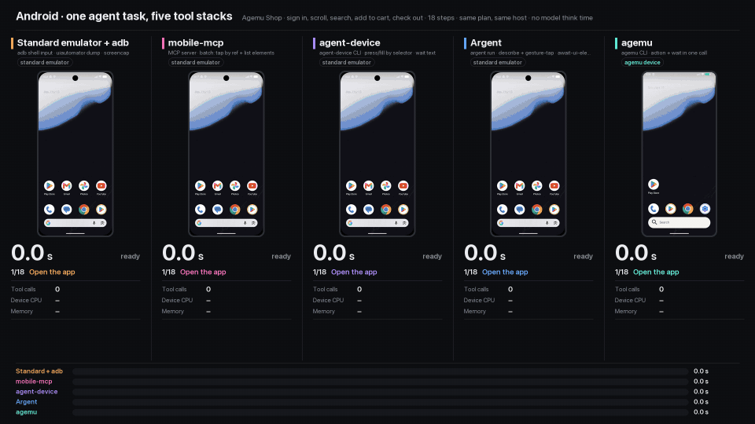
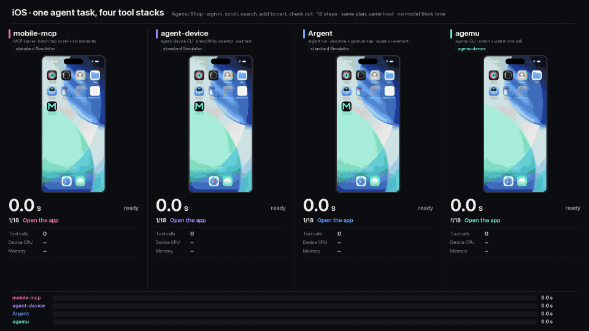

# Agent race: agemu against adb, mobile-mcp, agent-device and Argent

One 18-step task in the [Agemu Shop](../shop) app, driven the way an agent's tool calls drive it,
by every tool stack on the same Mac: on Android the standard emulator with `adb`, mobile-mcp,
agent-device and Argent, against agemu; on iOS a standard Simulator with mobile-mcp, agent-device
and Argent, against agemu.
Every run is recorded; the median run of each stack is rendered side by side, per platform and in
one montage.

<p align="center">
  <a href="out/grand-prix.mp4"></a>
</p>

The side-by-side recordings:

| Android | iOS |
|---|---|
| [](out/android/race.mp4) | [](out/ios/race.mp4) |

**Videos:** [the Grand Prix cut (38 s)](out/grand-prix.mp4) ·
[montage, both platforms (62 s)](out/montage.mp4) ·
[Android race, 5 stacks, real time](out/android/race.mp4) ·
[iOS race, 4 stacks, real time](out/ios/race.mp4)

The task: open the app, sign in, scroll the catalog to Bath Towel, open it, add it to the cart, go
back, search for "lamp", open Desk Lamp, set the quantity to 2, add it, open the cart, check that
the total is $91.98, check out with a shipping address, place the order, read the order number.
Every step waits for the screen it leads to; four steps also take a screenshot.

## Results

2026-11-15, one Apple M2 Pro Mac (16 GB) that other sessions used at the same time. Five runs per
stack, the stacks' order rotated every round; before a run the script waited, for 15 minutes at
most, until the host's 1-minute load average was under 5. The load after a run was 2.0-5.2 in the
Android series and 4.5-15.6 in the iOS one. All 45 runs completed the task. Every run, with its
host load, is in `out/<platform>/results.md`; each run's tool calls, frame index and CPU samples
are in `out/<platform>/runs/` (the frames are not committed).

agemu is v0.2.1 with one fix that this race led to, released as v0.2.2: on Android, text typed
right after a tap now waits for the tapped field's focus (see "Earlier series" below).

### Android

| | standard emulator + `adb` | mobile-mcp 1.0.17 | agent-device 0.21.37 | Argent 0.33.0 | agemu |
|---|---|---|---|---|---|
| task time | 73.5-76.7 s | 27.8-30.8 s | 23.8-24.2 s | 29.4-30.4 s | **10.1-10.6 s** |
| agemu is faster by (medians) | 7.0× | 2.7× | 2.3× | 2.8× | |
| tool calls | 64 | 32-33 | 33 | 66 | 34 |
| median tool call | 1.92 s | 771-974 ms | 774-795 ms | 323-339 ms | 134-272 ms |
| device CPU for the task | 33-37 CPU-s | 21-25 CPU-s | 14-16 CPU-s | 22-24 CPU-s | 10 CPU-s |
| the tool's host processes, CPU | 0.1 CPU-s | 0.7-0.8 CPU-s | 2.9-3.2 CPU-s | 6.5-7.6 CPU-s | 0.3 CPU-s |

### iOS

| | mobile-mcp 1.0.17 | agent-device 0.21.37 | Argent 0.33.0 | agemu |
|---|---|---|---|---|
| task time | 37.2-42.4 s | 34.0-37.7 s | 18.1-24.2 s | **15.7-16.8 s** |
| agemu is faster by (medians) | 2.4× | 2.2× | 1.2× | |
| tool calls | 48-63 | 26-27 | 66 | 35 |
| median tool call | 286-317 ms | 1.34-1.57 s | 174-179 ms | 238-460 ms |
| device CPU for the task | 22-26 CPU-s | 22-25 CPU-s | 10-14 CPU-s | 12-19 CPU-s |
| simulator memory (summed `phys_footprint`) | 3.77-4.01 GB | 3.82-3.90 GB | 3.79-3.85 GB | **1.85-1.91 GB** |
| the tool's host processes, CPU | 1.5-1.8 CPU-s | 7.2-8.0 CPU-s | 4.5-5.0 CPU-s | 1.4-1.6 CPU-s |

What the numbers show:

- **Android: reading the screen is the difference.** The `adb` arm spends 69-70 of its 74-77 s in
  33 `uiautomator dump`s (median 2.0 s each). Argent's `describe` on Android also runs a uiautomator
  dump, through its own on-device service (medians 0.28-0.42 s); agent-device reads through its own helper
  app, and its `--settle` waits for a quiet window after every action (a `press` took a median of
  1.1 s). mobile-mcp reads through its own on-device server: its element list alone took a median
  of 0.13-0.14 s, an action with the list after it about a second (medians 0.98-1.11 s) and a
  swipe 2.1 s. agemu's taps wait for their effect in the same call, from a warm on-device agent.
- **iOS: Argent is close; most of the time is the app's.** Argent taps by coordinates with no
  check that the screen has stopped moving, and scrolls without momentum. agemu loses its lead in
  three places: the tap right after scrolling waits 2.2-2.5 s for its momentum scroll to come to
  rest (agemu has no momentum-free swipe), the first paste into a field took 0.5-1.5 s, and every
  selector tap waits for a still screen. It has half the calls of Argent (35 against 66); with
  model think time each call is one more agent turn.
- **iOS: typing is where mobile-mcp and agent-device spend their time.** Entering the seven text
  fields (find, tap, type, and wait where the plan waits) took mobile-mcp 18.2-18.8 s and
  agent-device 15.3-15.5 s, against 6.1-12.3 s for Argent and 4.1-4.9 s for agemu. mobile-mcp
  has no wait tool, so over the whole task its arm read the screen 24-37 more times
  (6.9-10.5 s).
- **Calls.** mobile-mcp (with its batch tool), agent-device and agemu need about as many calls for
  the task, 26-35 on iOS and 32-34 on Android, apart from mobile-mcp's extra reads on iOS; `adb`
  and Argent need about twice as many (64-66).
- **iOS memory.** agemu's lean simulator held about half the memory of the standard one, as in
  agemu's [own measurements](../../docs/IOS.md#lean-simulators). On Android the emulator's `phys_footprint`
  moved between series of the same device (agemu-lab measured 2.7, 2.8, 2.9 and 3.1 GB in four
  series of one night, the standard emulator 3.6 to 4.2 GB), so the Android memory is not
  compared here.
- **Host processes.** On iOS, agent-device's XCTest runner and Argent's accessibility service run
  inside the simulator, so their CPU counts as the device's.

### Earlier series the same night

The Android race ran five more times that night before the series above, and once more that was
cut short, while the mobile-mcp arm was being finished. The host was short of memory for most of
them (other sessions ran their own emulator, simulator and builds; 4-9 GB of swap in use, load
average up to 15). They are not the result, but what failed in them is in
[out/android/earlier.md](out/android/earlier.md):

- **agemu, 2 of 26 runs:** text typed right after a tap on the next field went into the field
  that still had the focus ("LondonN1 9GU" in the City field), and the order was refused. That
  was a known agemu bug; it is fixed (`type` waits for the tapped field's focus,
  [docs/ANDROID.md](../../docs/ANDROID.md#caveats)), and the series above ran with the fix.
- **`adb`, 2 of 26 runs** failed at the sign-in; in the one that was looked at, `input text` had
  typed the first letter twice ("ttest@agemu.dev").
- **Argent, 2 of 27 runs:** a scroll that did not bring the item on screen, and an
  `await-ui-element` that timed out at the sign-in. **agent-device, 1 of 27:** `open` failed with
  "Could not read process state".
- **mobile-mcp, 4 of 27 runs**, all through gaps in the race's own arm, closed since: no second
  read after "No UI hierarchy was returned" (2), and a wrong turn after a lost swipe (2).

The times of the runs that completed were the same as above when the host was quiet: in the
second of those series (load 3-6) `adb` took 73.6-77.0 s, mobile-mcp 27.4-28.1 s, agent-device
23.6-26.6 s, Argent 29.3-30.4 s and agemu 9.9-10.5 s.

## How it was run

The plan is the same code for every stack ([plan.go](plan.go)); only the tools differ. Each driver
uses its tool as that tool's documentation tells an agent to ([drivers.go](drivers.go),
[drivers_tools.go](drivers_tools.go), [drivers_mcp.go](drivers_mcp.go)):

| agent step | `adb` (Android) | mobile-mcp | agent-device | Argent | agemu |
|---|---|---|---|---|---|
| launch | `am start -W` | `mobile_launch_app` | `open --relaunch` | `launch-app` | `launch` |
| find + tap | `uiautomator dump`, `input tap` at the centre | `mobile_click_on_screen_at_coordinates` with the ref from the element list | `press 'label="…"' --settle` | `describe`, `gesture-tap` at the frame's centre | `tap --text "…"` |
| wait for the next screen | dump again until the text is there | the element list in the same call, then `mobile_list_elements_on_screen` until the text is there | the settled diff, else `wait text` | `await-ui-element` | in the same call: `--wait-text` |
| enter text | tap, `input text` | the tap and `mobile_type_keys` in one call | `fill 'label="…"' --settle` | tap, `fill` | tap, `type` |
| scroll to an item | `input swipe` + dump, until it is on screen | `mobile_swipe_on_screen` and the element list in one call, until it is on screen | `scroll down --until 'label="…"'` | `gesture-swipe` without momentum + `describe` | `swipe --ui`, until it is on screen |
| read a value | dump | the latest element list | `snapshot --force-full` | `describe` | `ui` |
| screenshot | `exec-out screencap` | `mobile_save_screenshot` | `screenshot` | `screenshot` | `screenshot` |

- No model and no think time: the next call starts when the previous one returns, so the times are
  the tools' own. Each call is one process, as an agent with a shell runs it; agent-device and
  Argent forward it to their daemons.
- mobile-mcp has no CLI for an agent. Its arm keeps one MCP server for the run and each
  `tools/call` request is one call. Every action is one `mobile_batch_commands` call with
  `listElementsAtEnd`, as its instructions say ("Group known sequences into
  mobile_batch_commands"), so an action and the next read of the screen are one round trip.
- When a tap or fill finds no element, every driver reads the screen once more and retries once
  (agent-device with the ref its `snapshot -i` shows); the failed call's time counts.
- **Devices.** Android: the standard `Pixel_9_Pro` AVD started as a developer starts it
  (`emulator -avd Pixel_9_Pro`, window, 1280×2856, 2 GB guest; `-grpc` for the recording), and
  agemu's `agemu-lab` (1080×2424, 2 GB guest, no window, lean). iOS: a standard iPhone 17 Pro
  Simulator, and a lean iPhone 17 Pro that agemu created for the race. Same Android 37.1 and
  iOS 26.5 images.
- While one device ran, the other was paused where that is possible (emulator console
  `avd stop`, `agemu park`); a standard Simulator cannot be paused, so it stayed booted and idle
  during the agemu runs. Between stacks, mobile-mcp's, agent-device's and Argent's daemons and
  on-device helpers were stopped (they hold Android's single UiAutomation connection).
- **Untimed setup per run:** each tool's daemon warmed up, the app launched once and stopped,
  the home screen in front.
- **Recording**, the same for every stack and on the host: Android, the emulator's gRPC screenshot
  stream; iOS, `simctl io recordVideo`. CPU from `ps` every 0.5 s, memory with `footprint` every
  2 s (iOS: summed over the simulator's process tree).

### What had to change to make the race fair

- **The apps use visible text for every control** (`+` and `Quantity: 2`, not content
  descriptions; SwiftUI text fields get an accessibility label). agent-device on Android shows a
  button's text rather than its content description, and its `label=` selector on iOS does not
  match a SwiftUI field's placeholder.
- **The catalog is long enough that no stack scrolls to its end.** agemu's taps right after a
  swipe that reaches the end of the list were lost on both platforms (Android: 4 of 4 race runs;
  iOS: the one run tried): the list's overscroll or bounce takes the touch, and agemu's still-screen
  check does not wait for it. That is an open agemu bug.
- **mobile-mcp's arm works around what an agent would also meet.** The failed and the extra
  calls count.
  - Android: its element list shows a text field without its hint, so the arm fills the first
    empty text field on the screen and waits for the catalog by its title, not by its search
    field. An agent would need a screenshot to tell the fields apart; the arm is not charged for
    one.
  - iOS: the list can show a screen that still moves (a screen sliding in has the old screen's
    elements too; a list scrolls to rest for a second or two), and a ref is an element's place in
    the list. mobile-mcp has no wait tool, so the arm uses an element once two reads in a row
    have it under the same ref at the same place. The list also has rows that are under the
    app's header or below the screen; the arm counts a row as on screen between 28% and 88% of
    the height.
  - Its swipe has momentum and no speed setting, so one swipe can carry the list past the item:
    the arm then swipes back in shorter steps. The first swipe on a new screen can be lost: the
    arm swipes again.
  - Between two screens the list can fail with "No UI hierarchy was returned … try again": the
    arm reads the screen again. A click whose ref is gone is tried once more.
- **Google's "Save password?" sheet is off on the standard emulator**
  (`settings put secure autofill_service null`), for every stack. It came up after the sign-in
  in the first mobile-mcp run and covered the catalog; why it had not come up in the earlier
  race was not pinned down.
- **Gboard's stylus handwriting is off on the standard emulator.** After some runs, Gboard
  switched to its stylus mode and showed a tutorial sheet over the app; the cause was not
  pinned down (likely a tool's injected touches), and every later arm would have been blocked.

## Run it

```sh
make build
npm install --prefix ~/.cache/agemu-race-tools @swmansion/argent@0.33.0 agent-device@0.21.37 \
  @mobilenext/mobile-mcp@1.0.17
emulator -avd Pixel_9_Pro -port 5600 -grpc 8600 &     # the standard Android emulator
agemu boot android:agemu-lab
examples/agent-race/run.sh android                    # 5 rounds, then out/android/race.mp4

xcrun simctl create race-iphone-17-pro com.apple.CoreSimulator.SimDeviceType.iPhone-17-Pro \
  com.apple.CoreSimulator.SimRuntime.iOS-26-5 && xcrun simctl boot race-iphone-17-pro
examples/agent-race/run.sh ios                        # then out/ios/race.mp4, out/montage.mp4
```

`run.sh` builds and installs the apps, rotates the stacks (`ROUNDS`, default 5), writes
`results.md`, `summary.md` ([stats.py](stats.py)) and `picked.json` (the median run of each stack),
and renders with [compose.py](compose.py) (2-5 stacks side by side) and [montage.py](montage.py)
(the montage and the GIF teaser; Pillow through `uv`, and ffmpeg). On a Mac that does other work
too, `QUIET_WAIT=900` makes every run wait, for that many seconds at most, until the 1-minute load
average is under `QUIET_LOAD` (default 5); `FIRST_ROUND=3 SKIP_DONE=1` continues a series that
was interrupted.

The Grand Prix cut is rendered on its own, from the same picked runs:

```sh
uv run --with pillow examples/agent-race/grandprix.py \
  --out examples/agent-race/out/grand-prix.mp4 --gif examples/agent-race/out/grand-prix.gif
```

[grandprix.py](grandprix.py) reads every time on screen from the runs; its commentary lines are
written for the committed runs (which step each stack was in at that second), so read them again
after a new series. It needs macOS's fonts.

One run on its own:

```sh
go run ./examples/agent-race run --platform ios --arm argent --device <udid> --out /tmp/race/argent
```
