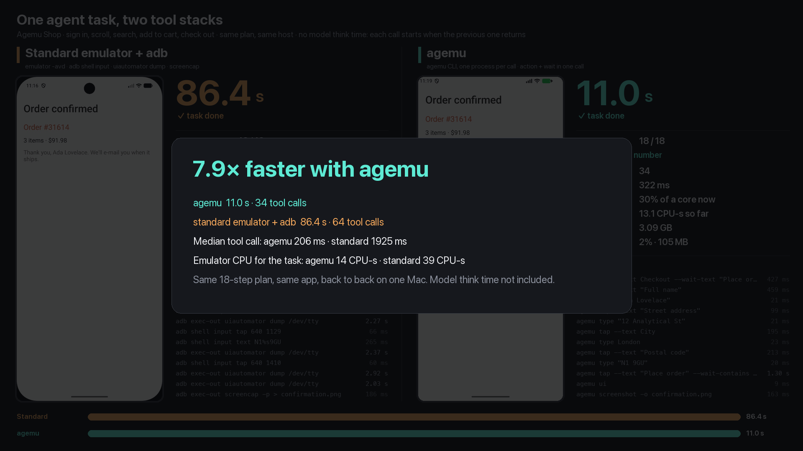

# Agent race: the standard emulator and adb against agemu

One task in the [Agemu Shop](../shop) app, driven the way an agent's tool calls drive it, on the
standard Android emulator with `adb` and on an agemu device. Both runs are recorded and rendered
side by side, in real time.

[](out/agent-race.mp4)

**[Watch the video (out/agent-race.mp4, 92 s)](out/agent-race.mp4)**

The task, 18 steps: open the app, sign in, scroll the catalog to Bath Towel, open it, add it to
the cart, go back, search for "lamp", open Desk Lamp, set the quantity to 2, add it, open the
cart, check that the total is $91.98, check out with a shipping address, place the order, read
the order number. Each step waits for the screen it leads to, and the agent takes a screenshot
at four checkpoints.

## Result

2026-11-07, one M2 Pro Mac (16 GB) that other sessions used at the same time. Three runs per side,
alternated; while one side ran, the other device was paused.

| | standard emulator + `adb` | agemu |
|---|---|---|
| task, start to order number | **86.4 s, 90.1 s** (a third run failed, below) | **10.7 s, 11.0 s, 11.0 s** |
| tool calls | 64 | 34 |
| median tool call | 1.93-1.94 s | 0.19-0.26 s |
| reading the screen | 33 `uiautomator dump`s, 79 s in all (median 2.0-2.3 s each) | in the action's call (`--wait-text`), or `agemu ui` (10-16 ms) |
| emulator CPU for the task | 39-45 CPU-s | 12-14 CPU-s |
| emulator memory (`phys_footprint`, median) | 4.16-4.17 GB | 3.11-3.15 GB |

About 8× less time for the same plan, nearly all of it from reading the screen: the standard arm
spends 91% of its time in `uiautomator dump`. agemu's emulator works harder while the task runs
(over 100% of a core against about 40%), but for an eighth of the time, so it uses about a third
of the CPU in all.

Every run is in [out/results.md](out/results.md), with the host load; each run's tool calls,
frames index and CPU samples are in `out/runs/` (the frames themselves are not committed).

The first standard run failed: the host's load average went to 38 (other sessions' builds and
devices), `adb shell input text` took 57 s, the app showed "isn't responding" and the sign-in
never completed. The agemu run right after it, at a load of 35, took 10.7 s. One overloaded run
says little about either tool; it is reported, not dropped.

## What the two sides do

The plan is the same code for both sides ([plan.go](plan.go)); only the tools differ
([drivers.go](drivers.go)). There is no model in the loop and no think time: the next call starts
when the previous one returns, so the times are the tools' own. With a model, each of the 64 or
34 calls also waits for the model's turn, which widens the gap in absolute time (30 more turns)
and narrows it as a ratio.

| agent step | standard: an agent with a shell and `adb` | agemu: the CLI, one process per call |
|---|---|---|
| find an element | `adb exec-out uiautomator dump /dev/tty`, parse the XML | in the same call: `agemu tap --text "Sign in"` |
| tap it | `adb shell input tap X Y` at its centre | |
| wait for the next screen | dump again until the expected text is there | in the same call: `--wait-text "Search products"` |
| type | `adb shell input text` | `agemu type` (waits until the app applied the text) |
| scroll | `adb shell input swipe`, then a dump | `agemu swipe ... --ui` (returns the screen) |
| look at the screen | `adb exec-out screencap -p` | `agemu screenshot` |

The standard side runs on the `Pixel_9_Pro` AVD started as a developer starts it,
`emulator -avd Pixel_9_Pro` (window, its own settings: 1280×2856, 2 GB guest), plus `-grpc` for
the recording. The agemu side runs on `agemu-lab` (1080×2424, 2 GB guest, no window, host GPU,
lean baseline). Both use the same Android 37.1 arm64 image. The devices differ in screen size and
window, so the memory and CPU rows compare the devices as each side runs them; the time comes
from the tools (the screen reads above).

The recording is the same on both sides: the emulator's own gRPC screenshot stream at 540 pixels
wide, read on the host, so nothing runs in the guest for it. CPU is sampled with `ps` every
0.5 s, memory with `footprint` every 2 s.

## Run it

```sh
make build
agemu boot android:agemu-lab
emulator -avd Pixel_9_Pro -port 5600 -grpc 8600 &   # the standard side
examples/agent-race/run.sh                           # 3 runs per side, then the video
```

`run.sh` builds and installs the app on both devices, alternates the runs (`ROUNDS`, default 3),
writes `out/results.md`, picks the median successful run of each side and renders
`out/agent-race.mp4` and its closing frame with [compose.py](compose.py) (Pillow, through
`uv run --with pillow`; ffmpeg). `CLASSIC_AVD` and `AGEMU_AVD` choose other devices. One run on
its own:

```sh
go run ./examples/agent-race run --arm agemu --avd agemu-lab --out /tmp/race/agemu
go run ./examples/agent-race run --arm classic --avd Pixel_9_Pro --out /tmp/race/classic
```

## What it found in agemu

The first version of the plan scrolled to Wool Blanket, near the end of the catalog. The third
swipe reaches the end, and agemu's selector tap on Wool Blanket right after it opened nothing in
4 of 4 race runs. The daemon's trace shows the tap judged at rest after 141 ms (no window
transition, the element's frame unchanged across two posted frames); the recorded frames show the
rows still moving for about 0.6 s after the swipe returned, as Android's stretch overscroll
relaxes. The likely cause: the stretch moves the rows on screen but not in the UI tree, so the
rest check passes while the list still takes the touch to end the stretch. The same calls from a
shell loop, a little slower between calls, landed 4 of 4. The plan now scrolls to Bath Towel,
which does not reach the end, on both sides. The lost tap is an open agemu bug.
